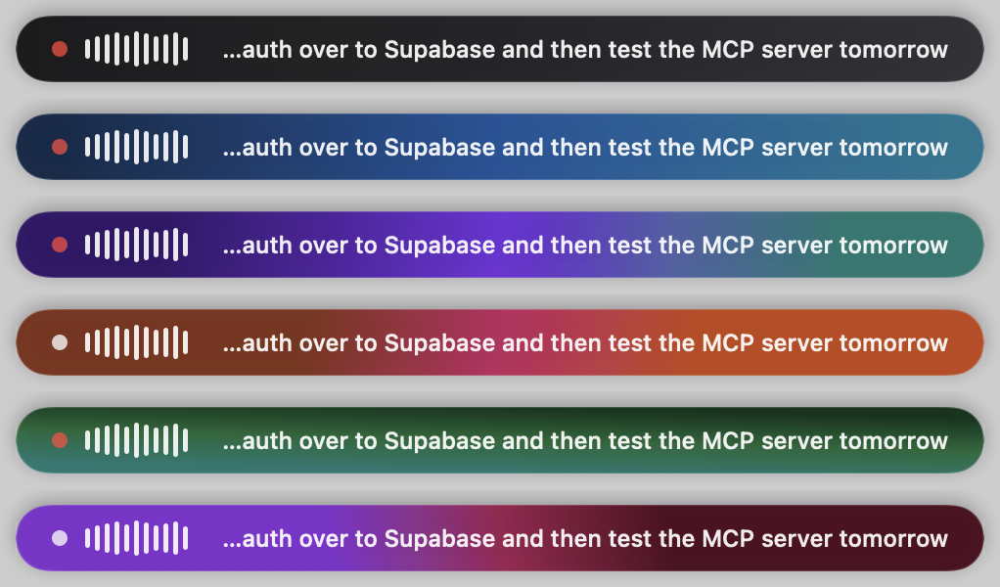
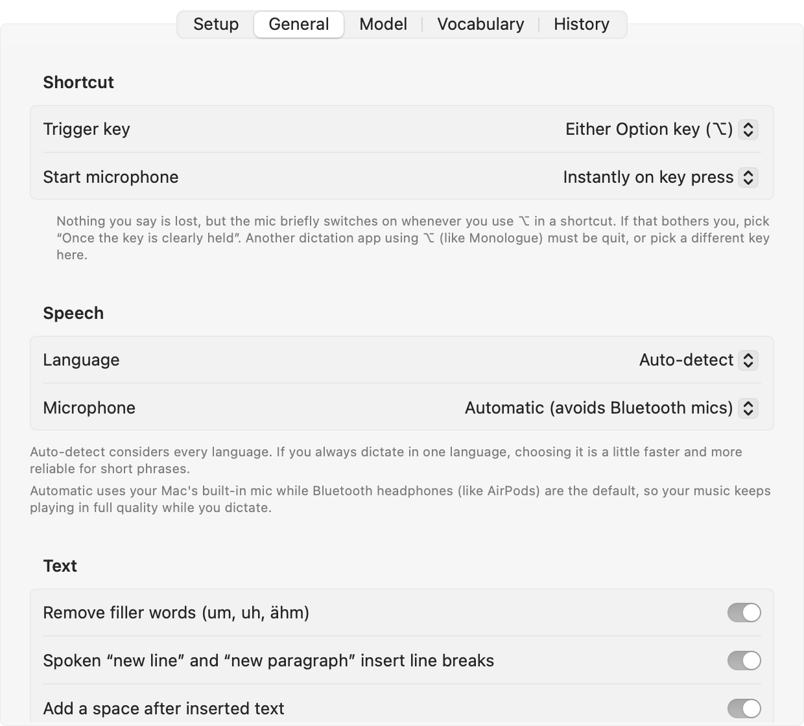

# Transcriber

Voice dictation for macOS that runs entirely on your Mac. Hold a key, talk, let go, and your words appear in whatever app you're using.



## Why I built this

I was paying $10 a month for a dictation app that sent everything I said to someone else's servers. So I built my own.

Transcriber runs on your Mac and nowhere else. Your voice never leaves it. No account, no subscription, no data collection. I believe AI that touches your personal data should run locally and belong to the people using it. This is my small piece of that.

## What it does

- **Works in any app.** Chrome, Slack, Notes, Mail, ChatGPT: wherever your cursor is.
- **Fast.** A typical sentence is ready 0.2 to 0.6 seconds after you let go (MacBook Pro M3).
- **Accurate.** OpenAI's Whisper Large v3 Turbo, running on your Mac's GPU. Punctuation included, "um"s removed.
- **Knows your words.** Add names and jargon (Docker, MCP, Supabase…) and it spells them right. Fix a word once in History and it remembers.
- **Look around while you talk.** Switch apps or browse mid-sentence; the text still lands where you started.
- **History.** Your last 100 dictations, stored only on your Mac.
- **Stays out of the way.** A small pill shows it's running; drag it anywhere and pick a color. 0% CPU when idle.

## Install

You need an Apple Silicon Mac with macOS 14 or newer.

```sh
xcode-select --install     # Apple's command line tools, if you don't have them
brew install cmake
git clone https://github.com/madebyjs8/transcriber.git
cd transcriber
make install
```

This builds the app (the first build takes about a minute) and puts it in `/Applications`. The setup window then asks for three things:

1. **Microphone**, to hear you.
2. **Accessibility**, to notice the shortcut key and paste text into other apps.
3. **The speech model** (574 MB, downloaded once from Hugging Face and checked for integrity).

Builds are signed with a local identity kept in `.signing/`, so macOS keeps these permissions when you update. Nothing is added to your keychain.

## Using it

| | |
| --- | --- |
| **Hold ⌥** | Talk while holding, release to paste. |
| **Double-tap ⌥** | Hands-free: talk as long as you like, press ⌥ again to finish. |
| **Click the pill** | Start or finish hands-free. Right-click it for more options. |
| **Esc** (while holding) | Stop without pasting. The text is kept in History. |

The shortcut key can be either ⌥, right ⌥ only, left ⌥ only, right ⌘ or fn. Click the Dock icon to open your History. Everything else is in Settings: language, microphone, vocabulary, pill color and model.



## Privacy

- Speech recognition happens on your Mac, with [whisper.cpp](https://github.com/ggml-org/whisper.cpp) on the GPU.
- The app only goes online to download the speech model, and only when you click Download.
- History lives in `~/Library/Application Support/Transcriber` and can be switched off.

## How it's fast

Whisper always processes 30 seconds of audio, even for a two-second sentence. On an M3 that alone takes over a second. Transcriber shrinks that window to fit each clip, which makes short dictations 3 to 6 times faster with the same text:

| You say | Standard Whisper | Transcriber |
| --- | ---: | ---: |
| "Sounds good, thanks." | 1.3 s | 0.21 s |
| A German sentence (4 s) | 1.4 s | 0.24 s |
| Two sentences (10 s) | 1.4 s | 0.51 s |

Two details made this work: Metal's flash attention produces garbage with shortened windows, so it's turned off, and windows under 5 seconds are unreliable, so that's the minimum.

## Development

```sh
make test     # logic tests (gestures, text cleanup, vocabulary)
make run      # build and launch from build/

# Transcribe a file from the command line, with timings:
/Applications/Transcriber.app/Contents/MacOS/Transcriber --transcribe clip.m4a
```

The pieces, in `Sources/`:

- `TranscriberCore/`: pure logic (gesture state machine, text cleanup, vocabulary learning), covered by `make test`.
- `Transcriber/`: the app. Keyboard monitor, recorder, Whisper engine, paste, the pill, and settings.
- `scripts/`: building whisper.cpp, the app bundle and the signing identity.

## License

MIT. Built on [whisper.cpp](https://github.com/ggml-org/whisper.cpp) and OpenAI's [Whisper](https://github.com/openai/whisper), both MIT licensed.
